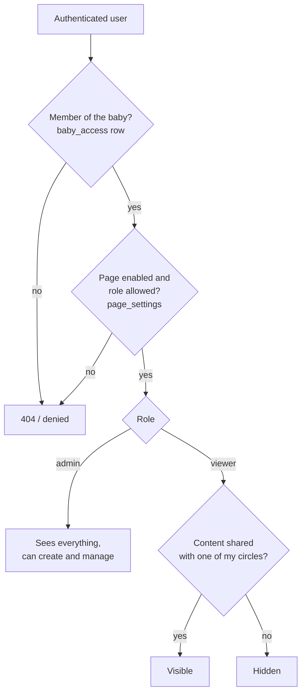

# Authorization

Up: [[Le petit monde]] · See also [[Authentication]], [[Row Level Security]], [[Page settings]]

Three layers decide what a user can see or do on a baby.

## 1. Baby membership and role

`baby_access` links a user to a baby with an `access_level` (`Enums<'role'>`: `admin` or `viewer`), plus per-baby profile fields such as the nickname and relation to the baby.

- `getUserAccess(babyId)` (`actions/users.ts`) returns the caller's own row, memoized per request.
- `assertIsAdmin(supabase, babyId)` (`actions/access.ts`) throws unless the caller is an admin.
- `getMemberAccess(supabase, userId, babyId)` (`member-access.ts`) is the version for [[Core modules]] that receive a trusted user id.
- The last admin of a baby can't be demoted.

## 2. Page settings

Each page (feed, calendar, tracker...) has a default from `PAGE_REGISTRY` that an admin can override per baby: enabled or disabled, and the minimum role. `assertPageAccess(babyId, pageId)` guards every protected page and the cores. See [[Page settings]].

## 3. Circles

Circles (`circles`, `circles_access`) are groups of members inside a baby ("Grandparents", "Close friends"...). Content tables have a join table to circles: `posts_circles`, `stories_circles`, `events_circles`, `anecdotes_circles`, `albums_circles`.

The rule is the same everywhere:
- **No circle attached → admin-only.**
- Otherwise visible to admins plus members of at least one attached circle.

Comments are the exception: they store a `circle_ids` snapshot of the author's circles at write time.

## Guards for child ids

`src/utils/feed-access.ts` checks that every id coming from the client (post, story, comment, poll, option, highlight, circle, storage path) belongs to the `babyId` in the URL and is visible to the caller before an action touches it (`assertPostVisible`, `assertCommentVisible`, `assertCirclesInBaby`, `canViewStorageObject`...). A missing item and a hidden item fail the same way, so ids can't be probed.

## Notification recipients

`getVisibleUserIds(babyId, circleIds)` and `getBabyAdminIds` compute who may be notified about a piece of content, using the same circle rule. When an edit adds a circle, only the newly visible users are notified. See [[Notifications pipeline]].
