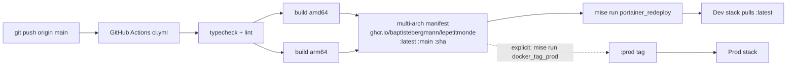

# Build and deploy

Up: [[Le petit monde]] · See also [[Deploying]]

- **The image is built only by CI**, never locally. A push to `main` *is* the build.
- Multi-stage `Dockerfile`: deps → build → standalone runner, non-root user.
- **Runtime configuration only**: all settings are env vars on the container (`SITE_URL`, `SUPABASE_URL`, `SUPABASE_PUBLISHABLE_KEY`, `SERVICE_ROLE_KEY`, `VAPID_*`, `RESEND_API_KEY`, `EMAIL_FROM`, `DEFAULT_LOCALE`, `WEB_VITALS_ENABLED`). The single build arg is `NEXT_PUBLIC_COMMIT_SHA`, shown in the footer.
- **Portainer** runs `docker-compose.portainer.yml` (`pull_policy: always`). It pulls the image; it never builds.
- **Two environments**: `:latest` is dev, `:prod` is promoted by hand once dev looks right. Both stacks run side by side on different domains and **share one database**, so migrations must stay backward compatible with the code running on `:prod` (additive first, tightening later).
- Public exposure through a Cloudflare Tunnel (`docker-compose.cloudflared.yml`). `/api/mcp`, `/api/oauth/*` and `/.well-known/*` must not be behind a Cloudflare challenge.

Other compose files: `docker-compose.yml` (local image test), `docker-compose.full.yml` (app + the self-hosted Supabase bundle in one project).
