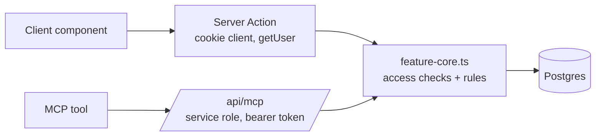

# Core modules

Up: [[Le petit monde]] · See also [[Server and client split]], [[MCP server]]

Features reachable from both the web app and the [[MCP server]] keep their business rules in a `src/utils/<feature>-core.ts` module:

- `todo-core.ts` → [[To-do list]]
- `care-core.ts` (+ `care-validation.ts`, `care-time.ts`, `care-timezone.ts`) → [[Baby tracker]]
- `inventory-core.ts` → [[Inventory]], [[Buy list]]
- `events-core.ts` → [[Calendar]]
- `anecdotes-core.ts` → [[Anecdotes]]
- `circles-core.ts` → circles listing
- `health-core.ts` → [[Health]]
- `digest-core.ts` → the MCP `get_digest` summary (composes the other cores)

## The contract

- A core function takes a Supabase client and a **trusted** `userId` as parameters.
- It re-checks access itself: membership through `member-access.ts`, the admin level when needed, and the page's [[Page settings]].
- It is **not** a `'use server'` file, so it can't be called from the browser.

The server action passes the cookie-bound client, so [[Row Level Security]] applies as a second layer where it is enabled. The MCP route passes the service-role client and the user id resolved from the token; there the core's own checks are the protection.

Some web wrappers pass `enforcePage: false` because the web app historically checked the page only at page level; MCP callers always enforce it, so a disabled page blocks its tools.
