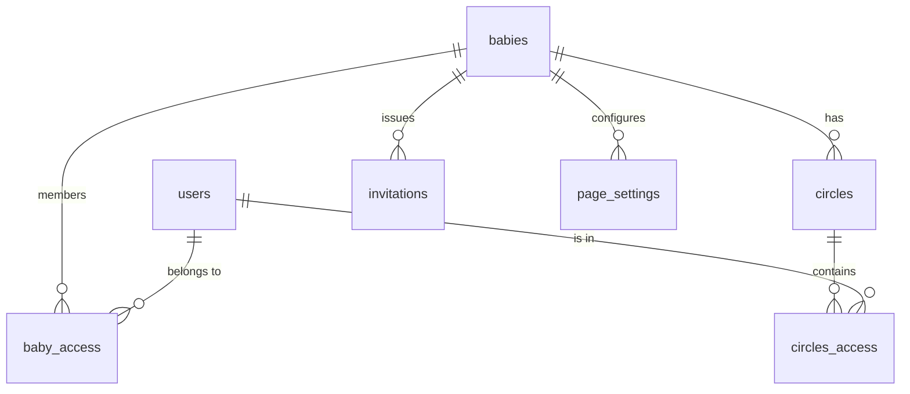
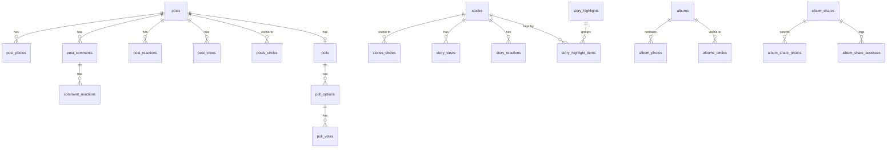

# Data model

Up: [[Le petit monde]] · See also [[Row Level Security]], [[Database migrations]]

Postgres schema `public`, defined only by the SQL files in `supabase/migrations/`. TypeScript types are generated into `src/utils/supabase/database.types.ts` (`mise run update_types`); code always uses `Tables<'...'>` and `Enums<'...'>` from there.

## Core: babies, people and circles

| Table | Purpose |
|---|---|
| `babies` | One row per baby / journal. |
| `users` | App profile, 1:1 with `auth.users`. |
| `baby_access` | Membership: `access_level` (`admin`/`viewer`), nickname, relation. See [[Authorization]]. |
| `circles`, `circles_access` | Groups of members used for content visibility. |
| `invitations` | Single-use, expiring signup links (`used_at`, `used_by`, `revoked_at`). See [[Authentication]]. |
| `page_settings` | Per-baby page overrides. See [[Page settings]]. |

## Content

| Tables | Feature |
|---|---|
| `posts`, `post_photos`, `post_comments`, `post_reactions`, `post_views`, `posts_circles`, `comment_reactions` | [[Feed]] |
| `polls`, `poll_options`, `poll_votes` | [[Polls]] |
| `stories`, `stories_circles`, `story_views`, `story_reactions`, `story_highlights`, `story_highlight_items` | [[Stories]] |
| `events`, `events_circles` | [[Calendar]] |
| `anecdotes`, `anecdotes_circles` | [[Anecdotes]] |
| `albums`, `albums_circles`, `album_photos` | [[Albums]] (`album_photos.album_id` is optional: the "All photos" library; `source_post_id`/`source_story_id` link mirrored feed photos) |
| `album_shares`, `album_share_photos`, `album_share_accesses` | [[Share links]] |
| `guess_questions`, `guesses` | [[Guessing game]] |

## Family organisation and care

| Tables | Feature |
|---|---|
| `inventory_items` | [[Inventory]] and [[Buy list]] (`quantity_owned`, `quantity_target`) |
| `todo_items` | [[To-do list]] |
| `care_events` | [[Baby tracker]] (one polymorphic table: sleep, breastfeed, bottle, diaper) |
| `baby_health_profiles`, `growth_measurements`, `vaccinations` | [[Health]] |

## Platform

| Tables | Feature |
|---|---|
| `notifications`, `notification_preferences`, `notification_settings`, `push_subscriptions` | [[Notifications pipeline]] |
| `bug_reports` | [[Bug reports]] (not baby-scoped) |
| `api_tokens`, `oauth_clients`, `oauth_grants` | [[MCP server]], [[OAuth authorization server]] |

## Enums

| Enum | Values |
|---|---|
| `role` | `admin`, `viewer` |
| `event_kind` | `occasion`, `life_stage`, `medical` |
| `milestone_type` | `first_steps`, `first_tooth`, `first_word`, `first_smile`, `first_laugh`, `birthday`, `other` |
| `care_event_kind` | `sleep`, `breastfeed`, `bottle`, `diaper` |
| `diaper_poop_color` | `black`, `green`, `yellow`, `brown`, `red`, `white` |
| `diaper_poop_texture` | `liquid`, `seedy`, `soft`, `formed`, `hard` |
| `breast_side` | `left`, `right`, `both` |
| `item_condition` | `new`, `secondhand` |
| `baby_sex` | `female`, `male` |
| `bug_report_status` | `new`, `reviewed`, `fixed` |
| `notification_type` | `new_post`, `new_comment`, `new_pronostic`, `new_member`, `new_reaction`, `new_life_stage`, `circle_access_granted`, `new_story`, `new_anecdote`, `new_comment_reaction`, `new_story_reaction` |

## Database-side logic

Most rules live in the app, but a few things are in SQL because they must be atomic:
- Helper functions on `baby_access` (migration `baby_access_helper_functions`).
- An atomic, clamped "mark bought" update for the [[Buy list]] (concurrent taps).
- A unique partial index so only one tracker timer per kind runs per baby.
- A trigger that revokes a user's API tokens and OAuth grants when they stop being an admin of any baby.
