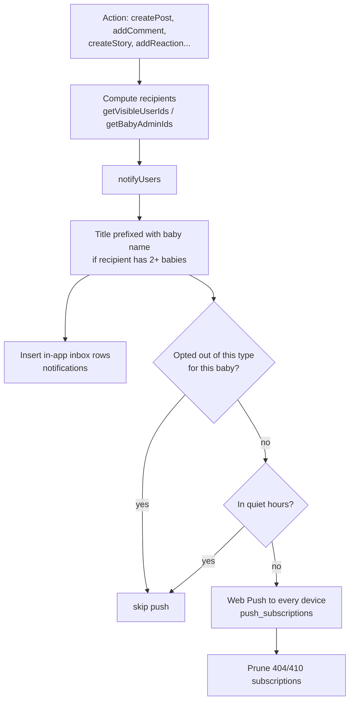

# Notifications pipeline

Up: [[Le petit monde]] · See also [[PWA and service worker]], [[Settings and profile]]

Every notification goes through one function: `notifyUsers()` in `src/utils/actions/notify.ts`.

- **Inbox first**: a `notifications` row is always written, so the header bell shows it even without push.
- **Baby name**: recipients who belong to 2+ babies get the title as `{baby} · {title}` (`pushNotifications.babyTitle`, name capped at 30 characters), in both the push and the inbox row. Single-baby members keep the short title. If the name can't be read, the title is sent unprefixed and a warning is logged. Inbox titles are fixed at send time, so older rows are not backfilled.
- **Tag**: the push tag is `type:babyId`, so pushes about different babies don't replace each other on the device, while the same type for the same baby still collapses.
- **Preferences**: `notification_preferences` is a sparse per-baby, per-type opt-out; `notification_settings` holds quiet hours (evaluated in `FAMILY_TIME_ZONE`). Both are edited from the bell popover in the header.
- **Push**: `web-push` with VAPID keys (`webpush.ts`), one row per device in `push_subscriptions` keyed by endpoint. Expired endpoints are deleted.
- **Never throws**: a failing notification is logged and swallowed so it can't break the action that triggered it.
- **Recipients respect circles**: only users who can see the content are notified; editing visibility notifies only the newly visible users.
- Types are listed in the `notification_type` enum and `notification-types.ts` (see [[Data model]]).

## Email

`src/utils/email.ts` sends through Resend (`RESEND_API_KEY`, `EMAIL_FROM`): welcome email, invitation email, new-post email and the admin **broadcast** email (`actions/broadcast_email.ts`, admin-only, sent to the members who can see the chosen circles). Sends are throttled (`sendThrottled`).
