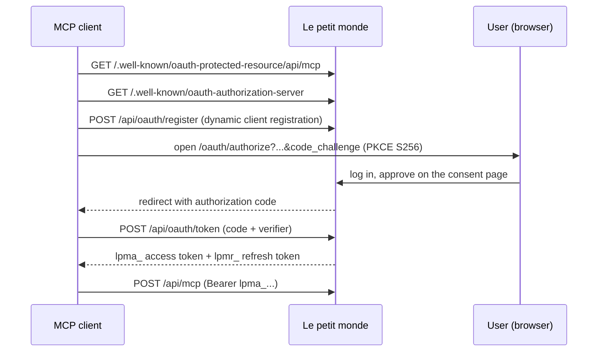

# OAuth authorization server

Up: [[Le petit monde]] · See also [[MCP server]], [[Authentication]]

Clients that can't send a custom header (Claude.ai connectors, the Claude mobile app, Gemini CLI) connect to the [[MCP server]] with OAuth 2.1. The app is its own authorization server.

| Piece | Location |
|---|---|
| Discovery metadata | `app/.well-known/*`, `utils/oauth/metadata.ts` |
| Client registration | `app/api/oauth/register`, `utils/oauth/clients.ts`, `redirect-uri.ts` (allow-list) |
| Consent page | `app/(auth)/oauth/authorize`, `utils/oauth/authorize-request.ts`, `eligibility.ts` |
| Tokens | `app/api/oauth/token`, `app/api/oauth/revoke`, `utils/oauth/tokens.ts`, `pkce.ts` |
| Storage | `oauth_clients`, `oauth_grants` (tokens stored as sha256, RLS on) |
| Rate limits | `oauth-limiters.ts` |

## Lifetimes (`utils/oauth/config.ts`)

- Authorization code: 2 minutes.
- Access token (`lpma_`): 1 hour.
- Refresh token (`lpmr_`): 30 days, rotated on every use; reusing an old one disconnects the app.
- A grant ends after 90 days at most.

Only admins of at least one baby can approve a connection. Connections show in [[Settings and profile|Settings > Connected apps]], where they can be disconnected. `SITE_URL` must be the public origin: every advertised URL and the token audience come from it.
