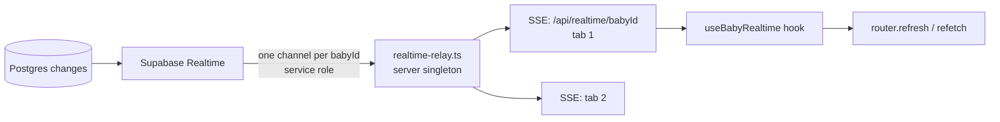

# Realtime

Up: [[Le petit monde]] · See also [[Architecture overview]]

Live updates reach the browser as **Server-Sent Events**, not as a browser WebSocket to Supabase (the browser has no Supabase client).

- `src/utils/supabase/realtime-relay.ts` keeps one upstream channel per baby and fans events out to every SSE connection for that baby. The channel is closed when the last listener leaves.
- `GET /api/realtime/[babyId]` authenticates the caller and checks membership before subscribing.
- Payloads are **stripped** (no row data, just table + event type) for most tables, so the relay can't leak content across circles. Clients refetch through Server Actions, which apply the normal [[Authorization]].
- `src/utils/hooks/use-baby-realtime.ts` subscribes on the client; consumers debounce refetches. Its optional `onReconnect` fires on every stream `open` after the first, because events sent while disconnected are lost. [[Baby tracker]] uses it, plus `visibilitychange`, `pageshow` and `online` listeners, to resync when the phone wakes.

`ADMIN_ONLY_TABLES` (exported by the relay: `todo_lists`, `todo_items`) lists tables whose signals only admins may receive, because the to-do page is admin-only. The SSE route computes `isAdmin` from the caller's `baby_access` row once per stream and drops those events for other members, so a consumer can't forget the filter. A demoted admin keeps receiving the bare signals until the stream is recycled (5 min). Their DELETE bindings can't be filtered by baby (like `care_events`), so another baby's admin may get one harmless refresh. Both tables are added to the `supabase_realtime` publication by a migration.

## Bound tables and consumers

| Table(s) | Consumer |
|---|---|
| `baby_access`, `users`, `circles`, `circles_access` | [[Admin console]] member and circle lists |
| `stories`, `story_highlights`, `story_highlight_items` | [[Stories]] tray |
| `inventory_items` | [[Buy list]] |
| `care_events` | [[Baby tracker]] (running timers across parents' phones) |
| `todo_lists`, `todo_items` | [[To-do list]] (admins only, see below) |
