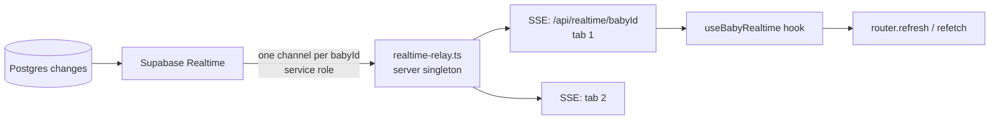

# Realtime

Up: [[Le petit monde]] · See also [[Architecture overview]]

Live updates reach the browser as **Server-Sent Events**, not as a browser WebSocket to Supabase (the browser has no Supabase client).

- `src/utils/supabase/realtime-relay.ts` keeps one upstream channel per baby and fans events out to every SSE connection for that baby. The channel is closed when the last listener leaves.
- `GET /api/realtime/[babyId]` authenticates the caller and checks membership before subscribing.
- Payloads are **stripped** (no row data, just table + event type) for most tables, so the relay can't leak content across circles. Clients refetch through Server Actions, which apply the normal [[Authorization]].
- `src/utils/hooks/use-baby-realtime.ts` subscribes on the client; consumers debounce refetches.

## Bound tables and consumers

| Table(s) | Consumer |
|---|---|
| `baby_access`, `users`, `circles`, `circles_access` | [[Admin console]] member and circle lists |
| `stories`, `story_highlights`, `story_highlight_items` | [[Stories]] tray |
| `inventory_items` | [[Buy list]] |
| `care_events` | [[Baby tracker]] (running timers across parents' phones) |
