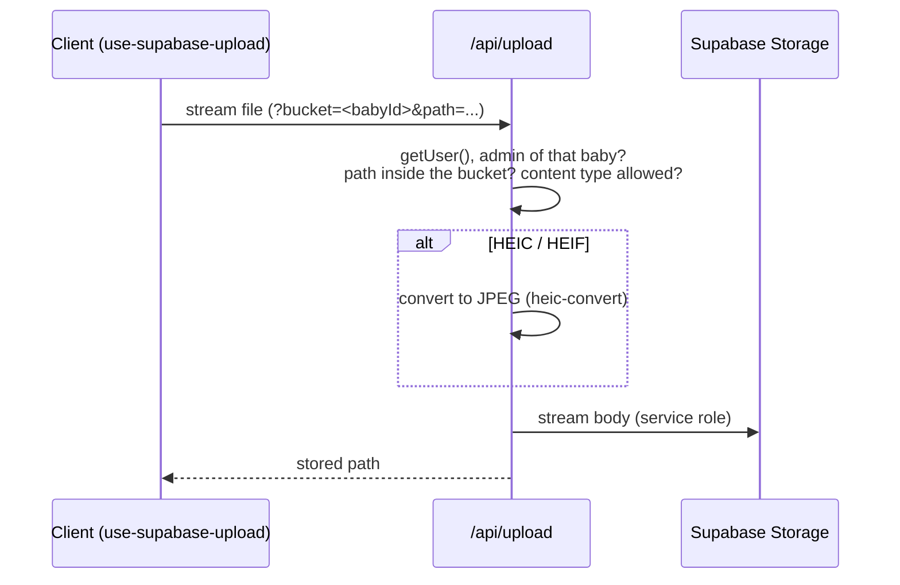

# Storage and media

Up: [[Le petit monde]] · See also [[Feed]], [[Albums]], [[Share links]]

## Buckets

- **One Supabase Storage bucket per baby**, named after the baby's UUID, created lazily (`ensureBabyBucket`).
- One shared bucket for [[Bug reports]] screenshots (`ensureBugReportsBucket`).
- Storage has no policies for browser clients: only the server, with the service-role key, reads and writes. Helpers live in `src/utils/actions/storage.ts` (not a `'use server'` file).

## Upload: `POST /api/upload`

- A route handler, not a Server Action, so large videos are streamed instead of buffered in memory.
- Allowed types are listed in `upload-content-types.ts`; paths are checked by `storage-path.ts`.
- iPhone HEIC photos are converted to JPEG server-side.
- Thumbnails: images get a server-generated thumbnail (sharp); videos get a JPEG captured client-side (`video-thumbnail.ts`) uploaded alongside.
- Photo metadata (`image-metadata.ts`) is read for dates and shown in the photo info dialog.

## Read: `GET /api/storage/[babyId]/[...path]`

- Checks the session, membership and that the caller can see the content the path belongs to (`canViewStorageObject` in `feed-access.ts`).
- Proxies the bytes through the app's own HTTPS origin. A raw Supabase signed URL would point at an internal LAN host and be blocked as mixed content.
- Implements HTTP `Range` requests, which iOS Safari requires to play `<video>`.

## Public reads

`GET /api/share/[token]/[photoId]` serves photos to holders of a [[Share links|share link]], with no session. It resolves the token on the service role and only serves photos that belong to that share. EXIF metadata is stripped on this route.
